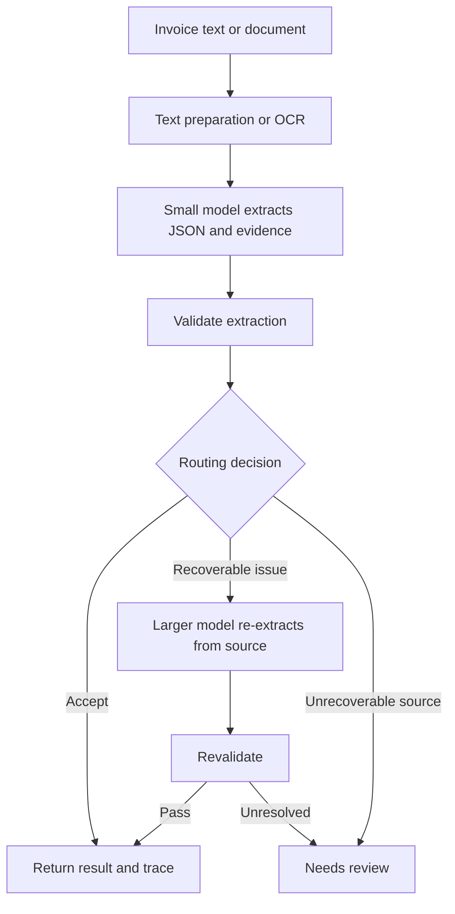

InvoiceRoute is a four-person hackathon project that turns invoice text into structured JSON using a specialized small open model, validates the extraction, and escalates difficult cases to a larger model. The goal is to measure whether the complete system can improve extraction quality over a competent frontier-model baseline while lowering average processing cost.

This handoff records the project direction agreed in conversation and the proposed implementation plan as of November 2, 2026. It is intended for a coding agent starting without the conversation history. Read the status and open decisions before treating a proposal as a fixed requirement.

# Project status and decisions

| Topic | Current state |
| - | - |
| Project | InvoiceRoute; invoice extraction and validation, not invoice generation |
| Intended user | An accounts-payable or finance-operations team preparing invoice data for downstream systems |
| Core approach | Small-model extraction, deterministic validation, selective larger-model escalation, unresolved-case review |
| Fine-tuning target | The language model that interprets OCR text and extracts fields |
| OCR | Existing OCR or PDF text extraction; no OCR-model training in the initial scope |
| Development stage | Planning and research; no project implementation, training run, deployment, or benchmark result has been established in this conversation |
| Data | DocILE is the preferred starting point; access, downloads, label conversion, and quality audit are not completed |
| Models | Exact small model and frontier/fallback model remain unselected |
| Platform | Fireworks is the intended platform in the hackathon context; exact supported checkpoints, training route, serving mode, and pricing need verification |
| First application input | Pasted invoice text; PDF/image ingestion follows once the text pipeline works |
| Benchmark | A custom JSON-extraction evaluation derived from reviewed invoice data, not an official DocILE localization leaderboard submission |
| Team | Four people, with proposed responsibilities below |
| Hardware context | The user previously reported an RTX 5070 and 32 GB system RAM. Exact GPU VRAM, OS, CUDA setup, and current availability are unverified |
| Other ideas | Job matching, B2B hiring signals, and tender qualification were explored but are not part of this handoff's implementation scope |

No percentage improvement, cost saving, supported-model claim, or production-readiness claim should be presented as established. Model size and fine-tuning method must be selected from actual compatibility and memory checks. Do not assume a 5070 Ti or infer VRAM from system RAM.

# Hackathon objectives and rubric

The user supplied photographs of the judging slides. The scoring weights were:

| Criterion | Weight | What the slides ask for |
| - | - | - |
| Benchmark evaluation | 40% | Reliable improvement over the baseline |
| Business value | 25% | A clear user, valuable problem, and benefit |
| Technical execution | 20% | A working, well-executed approach |
| Presentation and demo | 10% | A clear explanation and convincing result |
| Documentation | 5% | Readable code and reproducible evaluation |

The slides describe this sequence:

1. Choose a useful task, held-out cases, and success metric.

2. Establish a frontier-model baseline and save its score.

3. Build an open-model harness. Fine-tuning is optional.

4. Evaluate the system on the same held-out cases with the same scoring.

5. Report before/after scores, the gain, and reproducible evidence.

The stated goal is to beat the frontier on the chosen task. The recommended approaches include retrieval, tools, checks, improved prompts/workflows, fine-tuning, and model routing.

Interpretation for InvoiceRoute: extraction-quality improvement is the primary ambition. Lower cost at similar accuracy is useful, but the supplied slides do not establish that cost savings alone fulfill the benchmark objective. Novelty has no separate scoring category.

The complete event rules, dates, submission format, mandatory provider usage, credits, and allowed fallback models were not provided. Verify them before treating platform or submission assumptions as requirements.

# Product goal and technical hypothesis

Original product pitch:

> Specialize the affordable model, escalate the exceptions, and measure the savings without hiding the errors.

The refined technical hypothesis is that domain-specific training and a carefully evaluated harness can reduce semantic extraction errors on unfamiliar invoice layouts. Cost savings are a second outcome to measure, not assume.

Prioritize these attributes:

1. Correct field meaning: invoice date versus due date, vendor versus customer, invoice number versus purchase order, invoice total versus amount due.

2. Unsupported-value avoidance: do not fabricate a missing subtotal, tax, currency, or date.

3. Generalization to new vendors and layout families.

4. Correct association of line-item descriptions, quantities, and prices.

5. Reliable escalation with measured errors among accepted invoices.

6. End-to-end cost and latency.

Existing services already offer invoice parsing, source locations, confidence, checks, and review workflows. The contribution is a reproducible improvement on a defined task, not a claim that invoice extraction or routing is new.

Routing to the same frontier model used as the baseline does not automatically outperform that baseline. The combined system needs useful complementary strengths: it must correct some baseline errors without introducing more errors elsewhere.

# Initial scope and boundaries

Recommended first scope:

- English, single-page invoice text with line breaks and useful table spacing.

- A versioned, fixed JSON schema.

- Core header fields and ordinary line items.

- An untuned small-model baseline, a fine-tuned variant, a frontier baseline, and routed-system evaluations.

- Source-linked evidence for critical fields when label alignment is available.

- A bounded workflow with explicit review outcomes.

- A simple demo backed by real stored evaluation outputs.

Defer multi-page/multilingual invoices, very long tables, sophisticated tax regimes, handwriting, ERP posting, payments, broad crawling, and a learned router until the core experiment works.

PDF/image support must retain the original source and record the OCR configuration. An image-capable fallback is a possible later extension, not part of the initial text-only comparison.

A harness is the surrounding application code: input preparation, prompting, model calls, validation, routing, and logging. It does not require a multi-agent framework. A small backend with clear modules is sufficient.

# Architecture

Two workflows share the schema and evaluator.

Training and experimentation:

1. Acquire permitted data and inspect representative examples.

2. Define field semantics, annotation rules, and scoring.

3. Split documents by vendor/template groups and remove duplicates.

4. Freeze the final test set and labels.

5. Run competent base-small and frontier baselines.

6. Analyze errors on development data.

7. Fine-tune the small extractor on training examples only.

8. Tune prompts, routing rules, and thresholds on validation data.

9. Evaluate frozen configurations on the final test set.

Application flow:



For the MVP, allow at most one configured larger-model fallback, with separately bounded parse/transport retries. Prevent infinite repair loops. A targeted retry using the small model is an optional later experiment.

Separate these interfaces:

| Component | Responsibility |
| - | - |
| Input adapter | Produce text/segments from pasted text or documents; record preprocessing |
| Extractor | Call a configured model and preserve raw and parsed outputs |
| Validator | Produce structured issues without rewriting source facts |
| Router | Select accept, fallback, or review based on issues and policy |
| Orchestrator | Execute the bounded workflow and collect trace data |
| Evaluator | Compare predictions with reviewed labels using fixed rules |
| Demo | Display source, output, issues, model calls, cost, latency, and aggregate results |

# Extraction contract

The schema below is a proposed starting contract. Finalize it after auditing available labels, then version and freeze it for the experiment.

Core fields:

- `vendor`: issuing/selling party, not the billed customer.

- `invoice_number`: invoice identifier, not PO number or payment reference.

- `invoice_date`: issue date, normalized only when unambiguous.

- `currency`: explicit or unambiguously supported currency. A bare dollar sign need not mean USD.

- `line_items`: separately grouped item records.

- `subtotal`: a clearly defined source amount before tax under the chosen annotation policy. Do not silently equate merchandise subtotal and net total when discounts or charges make them different.

- `tax`: stated tax total; absence is not automatically zero.

- `invoice_total`: final invoice amount including applicable stated adjustments and taxes, distinct from outstanding balance.

- `amount_due`: outstanding amount requested, if stated or otherwise allowed by the fixed policy.

Auxiliary fields such as `due_date`, `amount_paid`, `shipping`, and `discount` are useful for interpretation and validation. Include them only when their semantics and labels are supported.

Use exact decimal strings for money and Python Decimal for calculations. Never use binary floating-point arithmetic for monetary comparisons. Dates use ISO format when resolvable. Quantities must support fractions; select a consistent decimal representation.

Example source:

```text
[L01] NORTHSTAR OFFICE SUPPLIES
[L02] Invoice No: INV-2026-1042
[L03] Bill To: Acme Analytics
[L04] Invoice Date: October 12, 2026
[L05] Payment Due: November 11, 2026
[L06] Currency: USD
[L07] Description | Qty | Unit Price | Amount
[L08] USB-C Hub | 2 | 45.00 | 90.00
[L09] Wireless Mouse | 3 | 20.00 | 60.00
[L10] Subtotal: 150.00
[L11] Sales Tax: 12.00
[L12] Invoice Total: 162.00
[L13] Payment received: 50.00
[L14] Balance Due: 112.00
```

Example extraction:

```json
{
  "vendor": "Northstar Office Supplies",
  "invoice_number": "INV-2026-1042",
  "invoice_date": "2026-10-12",
  "due_date": "2026-11-11",
  "currency": "USD",
  "line_items": [
    {
      "description": "USB-C Hub",
      "quantity": "2",
      "unit_price": "45.00",
      "line_total": "90.00"
    },
    {
      "description": "Wireless Mouse",
      "quantity": "3",
      "unit_price": "20.00",
      "line_total": "60.00"
    }
  ],
  "subtotal": "150.00",
  "tax": "12.00",
  "invoice_total": "162.00",
  "amount_paid": "50.00",
  "amount_due": "112.00"
}
```

Keep source evidence in a parallel mapping, for example:

```json
{
  "invoice_date": {
    "source_lines": ["L04"],
    "raw_text": "October 12, 2026"
  },
  "invoice_total": {
    "source_lines": ["L12"],
    "raw_text": "162.00"
  },
  "amount_due": {
    "source_lines": ["L14"],
    "raw_text": "112.00"
  }
}
```

Stable segment IDs are generated by preprocessing, not by gold annotations. Evidence must be checked against actual input segments. Matching an amount to a source line establishes support, not proof that its semantic label is right.

Use `null` for absent or unresolved scalar values. Keep separate status metadata where needed, such as `present`, `absent`, `ambiguous`, or `unreadable`; these statuses need labeled examples and clear definitions. An unannotated dataset field is not automatically absent.

For line items, distinguish a verified empty list from an unreadable/unresolved table. Define this in the schema instead of treating all empty outputs as correct.

Keep extracted and computed values separate. Preserve a printed total even if it is inconsistent; attach a validation issue rather than silently correcting it. The final runtime response should separate `extraction`, `evidence`, `validation`, `routing`, and `trace`.

# Validation and routing policy

The initial validator and router are ordinary Python code, not a second model to fine-tune.

| Check | Behavior and limitation |
| - | - |
| JSON parsing and schema | Detect malformed output, wrong types, missing keys, and unexpected fields under the configured schema |
| Critical missing values | Flag unresolved business-critical fields without inventing replacements |
| Date validity | Reject impossible dates; flag ambiguous dates when context cannot resolve them |
| Source support | Validate segment IDs and normalized values against the source |
| Semantic ambiguity | Flag competing candidate dates, amounts, or parties when observable; rules will not catch every semantic error |
| Item arithmetic | Check quantity times unit price only when discounts, tax basis, units, and rounding make that identity applicable |
| Header arithmetic | Reconcile subtotal, taxes, and explicit adjustments under the supported invoice convention |
| Balance arithmetic | Compare invoice total, stated payments, credits, and amount due only when all relevant terms are available |
| Output completeness | Detect truncation, omitted pages/tables, or token-limit failures |

Arithmetic checks should return `pass`, `fail`, or `not_applicable` with evidence and a reason. A non-applicable check is not a pass. Define rounding tolerances by currency and supported convention; do not hardcode a universal one-cent tolerance for all currencies.

Routing outcomes:

- `accept`: no disqualifying issue detected under the configured policy.

- `escalate`: a problem may be resolved by another extraction attempt.

- `needs_review`: unresolved ambiguity, source loss, unsupported cases, or fallback failure.

Passing checks means no issue was detected, not guaranteed correctness. Raw model confidence or token probabilities are not calibrated correctness probabilities. Do not introduce a confidence threshold until its relationship to actual errors is measured on validation data.

When escalating, provide the original source and structured issue reasons. Avoid prompts that pressure the model to change numbers merely to balance arithmetic. If including previous predictions, measure whether they anchor the fallback to the same mistake.

Example: source says subtotal 150, shipping 20, tax 12, total 182. If shipping was omitted, flag an unexplained difference, re-extract the adjustment, then revalidate. If the source itself says inconsistent amounts and no explanation exists, retain the printed values and mark the issue unresolved.

If OCR removed an essential value, a larger text model cannot reliably recover it. Route to original-image inspection when available, otherwise review.

# Dataset plan

Preferred source: DocILE, which provides business documents, field annotations, line-item identities, layout groups, and precomputed OCR. Its documented annotations distinguish amount due, amount paid, gross/net/tax totals, issue/due dates, vendor/customer fields, and item attributes. Access and data terms must be verified before use.

Do not assume that the repository code license grants all document-data rights. Do not treat all business documents as invoices. Filter using available metadata and review representative samples.

Recommended preparation:

1. Obtain access and inspect a small diverse sample before bulk conversion.

2. Audit field presence, label quality, document types, and OCR readability.

3. Define explicit mappings into the target schema.

4. Preserve raw text, source segments, document IDs, layout groups, and label provenance.

5. Align annotations to OCR evidence conservatively and manually inspect failures.

6. Deduplicate and group related documents before splitting.

7. Write versioned train, validation, and frozen test manifests.

DocILE's official test labels are not public. For local JSON scoring, use an explicitly documented partition of accessible labeled documents. Do not claim an official benchmark score unless using its official tasks and evaluation route.

Proposed starting sizes, adjustable after inspection:

| Portion | Planning target |
| - | - |
| Real training invoices | 1,000 to 2,000 |
| Targeted synthetic training examples | 500 to 1,000 |
| Validation invoices | 200 to 300 |
| Frozen final test invoices | 300 to 500 |

These are planning targets, not guaranteed sample requirements. First run a pilot and a learning curve. Split before generating augmentations. Keep all source variants, repeated templates, and near duplicates in the same partition. Reserve entire layout/vendor families for generalization analysis.

Synthetic examples should address observed development errors:

- Invoice total versus amount paid versus balance due.

- Invoice date versus due, delivery, or order date.

- Vendor versus customer or payment recipient.

- Invoice ID versus PO/reference IDs.

- Missing tax versus explicit zero.

- Reordered columns, wrapped descriptions, and repeated table headers.

- Shipping, discounts, credits, and rounding where supported.

- Ambiguous or unreadable fields.

- Number formats with sufficient context for normalization.

- Contradictory printed amounts that must be preserved.

Use paired examples that change labels or relationships, not merely names and prices. Synthetic facts and arithmetic should be generated/checked programmatically; audit the rendered text against its labels. Never use final-test errors to generate training data.

For corrupted OCR, retain both underlying source truth and input recoverability. Do not train a text-only model to guess a number removed from the text. Decide in advance how these cases are scored and report recoverable versus unrecoverable subsets.

Supplemental resources:

- InvoiceOCR-Synth: synthetic images and structured labels, with repeated image-quality variants. Use relevant invoice types, keep variants together, and run OCR if evaluating OCR robustness. Its limited template families do not replace real-data coverage.

- InvoiceBenchmark: synthetic numerical and wording traps; separate printed-value extraction from recomputed arithmetic targets.

- CORD: useful for receipt parsing/line items, but receipts are not a substitute for B2B invoices.

Ground truth must be reviewed independently of model outputs. Larger-model predictions can propose training labels, but are not automatically gold labels. Unknown annotation coverage must be masked or reviewed; it must not become a false null target.

# Fine-tuning plan

The trained component is the small open language model that maps invoice text to structured fields and evidence. OCR remains fixed.

Proposed initial method: supervised fine-tuning with LoRA or QLoRA, subject to model, hardware, and Fireworks compatibility. Reinforcement learning, preference optimization, and training a separate router are not MVP requirements.

Each example contains:

- System instruction defining extraction behavior and schema.

- User message with invoice text/segments.

- Assistant message containing the reviewed target JSON.

Use the chosen provider's documented conversational JSONL format. In the assistant message, the JSON response is serialized as a string inside the training record. Validate every record before launching a job. Do not include test labels or split metadata in model inputs.

The model should learn field selection, item grouping, supported normalization, source references, and honest missing-value behavior. Arithmetic verification remains application code. Do not train unsupported guessing merely to maximize filled fields.

Before committing to a checkpoint:

1. Verify training and serving support for the exact model and adapter format.

2. Confirm context/output budgets on real invoices, including evidence overhead.

3. Inspect actual GPU VRAM and software compatibility for local training.

4. Establish a competent untuned baseline using structured output if supported.

5. Run a small pilot and inspect semantic errors, not just JSON validity.

6. Record model revision, dataset version, hyperparameters, seed, and checkpoint.

The user has not selected a specific small model, larger model, training location, deployment mode, or paid budget. A small model is a design goal, not a fixed parameter count.

Use Fireworks documentation to verify the deployment path when implementing. Do not assume local adapters can be uploaded unchanged or that every fine-tuned model has serverless per-token billing.

# Evaluation specification

Define evaluation before extensive training or UI work. The final benchmark is a frozen set of invoice inputs, reviewed answers, and deterministic scoring rules.

For the initial text experiment, all configurations receive identical OCR text and preprocessing. If an image-based fallback is added, evaluate it as a separate end-to-end track with comparable original-document access for the frontier baseline.

Primary proposed metric: critical-field correctness.

A document passes when every predefined critical field is correct after agreed normalization. The provisional set is vendor, invoice number, invoice date, currency, subtotal, tax, invoice total, and amount due. Freeze the final list after label auditing.

Critical-field correctness = documents with all critical fields correct / all final-test documents.

Only use documents with audited critical-field labels for this score, selected before running final models. If that is not feasible, disclose label coverage and use a predefined alternative; do not silently remove hard or unannotated cases after seeing predictions.

Supporting metrics:

| Metric | Definition or requirement |
| - | - |
| Per-field accuracy and precision/recall | Report present-field performance separately from absent-field performance |
| Unsupported extraction rate | Non-null predictions without supported source truth under the annotation policy |
| JSON/schema validity | Score raw output and final workflow output separately when retries or repairs occur |
| Line-item precision/recall and cell accuracy | Match rows one-to-one, handle duplicates, and penalize extra/missing rows |
| Unseen-layout performance | Publish alongside familiar-layout performance and sample counts |
| Escalation rate | Fraction invoking the fallback |
| Review rate | Fraction unresolved after the automated workflow |
| Automatic acceptance coverage | Accepted documents / all documents |
| Accepted-invoice error rate | Accepted documents with a critical error / accepted documents |
| Latency | End-to-end p50/p95, with concurrency and warm/cold conditions stated |
| Cost | Actual charged or explicitly estimated costs, including every call and retry |

Line items are separate from the critical-header score. Do not describe the header score as whole-invoice correctness. If all-field correctness is reported, it must also include line items and every required field.

Use exact normalized numeric/date comparison. Document conservative vendor/text normalization; avoid an LLM judge as the sole correctness scorer. A source-supported null can be correct; returning null for a known recoverable value is an error.

Retain every test document in accounting. Invalid output and truncated responses count as failures. Human corrections are not automated model successes. For a valid invoice flagged for review, its incomplete automation must remain visible; do not inflate accuracy by scoring only accepted cases. A separately labeled task may reward correctly detecting a genuinely inconsistent source.

Compare these configurations:

1. Competent frontier model with a reasonable prompt/schema.

2. Untuned small model.

3. Fine-tuned small model.

4. Untuned small model with the same validation/routing harness.

5. Fine-tuned small model with the same harness.

If feasible, also evaluate the frontier model with the same checks to isolate orchestration gains. Use reviewed labels, not agreement with the frontier output, as truth.

Fix model versions, prompts, schema, output budgets, normalization, and routing thresholds before the final run. Tune on validation only. Report paired uncertainty estimates on score differences; account for shared template families when resampling. Do not claim statistical significance from a tiny score difference without analysis.

Candidate final claim, populated only with measured results:

> InvoiceRoute achieved X percent critical-field correctness versus Y percent for the frontier baseline, at Z cost per invoice, with R percent unresolved for review.

# Cost measurement and trace data

For a sequential cascade, every invoice incurs the small-model call; escalated invoices incur the fallback as well. Do not model cost as though routed invoices skip the small call.

A useful approximation is:

Average cost = small-model cost + escalation rate times average fallback cost among escalated invoices + preprocessing/check/retry costs.

Compute the actual result from per-call usage whenever possible. Escalated documents may be longer than average. Report OCR costs if used, token-based serving costs or actual GPU billing, and training/deployment setup costs separately. Label estimated costs as estimates. Do not hide idle dedicated-deployment cost by quoting serverless prices.

Recommended trace fields:

- Request ID and dataset/document ID.

- Schema, prompt, preprocessing, and routing-policy versions.

- Model identifiers, revisions/checkpoints, and call stage.

- Raw response, parsed extraction, evidence, finish reason, and errors.

- Validation issues and their applicability.

- Route and escalation reason.

- Input/output/cached token usage when exposed.

- Call duration, complete workflow duration, and retry count.

- Cost basis, unit rates, pricing date, currency, and total per request.

- Final status: accepted by small model, accepted after fallback, or needs review.

Logs are evidence for evaluation and the demo. Keep credentials out of traces and version control.

# Proposed implementation sequence

The following stack is a practical default, not a previously fixed requirement: Python for data/training/evaluation and orchestration, Pydantic or equivalent for the schema, Decimal for arithmetic, simple JSONL/SQLite storage, and a lightweight API/UI. Choose FastAPI/Streamlit or an existing frontend based on the repository and team experience. Avoid unnecessary infrastructure.

Suggested modules:

| Module | Responsibility |
| - | - |
| schemas | Versioned extraction, evidence, issue, route, and trace contracts |
| data | Dataset adapters, audits, deduplication, splits, and training export |
| preprocessing | Text normalization and stable segment IDs |
| models | Provider adapters and interchangeable model configuration |
| validation | Deterministic source, date, completeness, and arithmetic checks |
| routing | Explicit policy and bounded orchestration |
| training | Fine-tuning configuration, export, and checkpoint metadata |
| evaluation | Matching, metrics, baselines, reports, and reproducible runs |
| app | Input UI/API and results display |
| tests | Meaningful fixtures for parsing, arithmetic applicability, routing, and evaluation |
| configs | Model/prompt/schema/policy settings |
| docs | Setup, data provenance, benchmark method, and measured results |

Milestones:

1. Audit data availability and actual runtime/hardware; settle schema semantics.

2. Implement a tiny fixture set, schema, and evaluator.

3. Run the frontier and untuned-small baselines on development data.

4. Freeze a final test manifest independently of model outcomes.

5. Build the text-input harness and store complete traces.

6. Fine-tune a pilot, analyze validation errors, and improve data coverage.

7. Tune routing on validation data and run controlled ablations.

8. Run the frozen final evaluation once configurations are settled.

9. Build the demo from real outputs and publish reproducible instructions.

Useful verification cases include vendor/customer swaps, due-date confusion, subtotal/total/balance swaps, explicit zero versus missing tax, legitimate shipping/discount adjustments, contradictory printed totals, invalid JSON, output truncation, fallback failure, and finite retry behavior.

Never populate a dashboard with invented metrics that look like measured results. Synthetic demo invoices should be labeled as such.

# Team responsibilities and demo

Proposed four-person split:

| Owner | Responsibility | Shared interface |
| - | - | - |
| Data preparation | Access, audit, labels, splits, targeted augmentation | Versioned invoice records and manifests |
| Fine-tuning and serving | Base-model selection, training, checkpoint/deployment | Extractor interface and model configuration |
| Evaluation and routing | Scoring, validation rules, escalation, cost accounting | Evaluation reports and route/issue contracts |
| Application and demo | Input UI, source/output comparison, trace/results display | Runtime response envelope |

Agree on schema and sample records before parallel implementation. These are human-team responsibilities, not a requirement to spawn autonomous coding agents.

Demo content:

- A straightforward invoice handled by the fine-tuned small model.

- A difficult invoice with a real detected issue, fallback, and final outcome.

- An unresolved example showing honest limitations if useful.

- Side-by-side source and extraction with supporting lines.

- Reasons for escalation and the actual models/calls used.

- Cost and latency for each request.

- Aggregate results over the full held-out set, including failures and review cases.

The two live examples illustrate behavior; they are not the benchmark.

# Open decisions and first actions for Codex

Resolve these in dependency order:

1. What files/repository and environment are actually available?

2. Is DocILE access available, and can its labels support the proposed schema?

3. Which field meanings and supported invoice conventions are in scope?

4. Which exact frontier and small checkpoints are permitted and supported?

5. What are the actual GPU VRAM, training route, serving mode, and budget?

6. What does the final schema include for auxiliary amounts, evidence, and missing-value statuses?

7. What grouped split and primary metric can be supported by audited labels?

8. Which baseline errors on development data justify fine-tuning or targeted checks?

9. Which routing rules improve the measured quality/cost tradeoff?

10. Which demo framework best fits the team and existing repository?

Handoff instructions for the next coding session:

Read this context and inspect the existing repository before changing files. Preserve existing work and applicable current repository instructions. Do not assume old conversation-specific AGENTS.md instructions remain in effect; the user explicitly revoked the earlier ones.

Start by establishing data availability, schema semantics, and a reproducible evaluation skeleton. Use a small local fixture set while data access or provider credentials are unresolved. Mark fixtures and mocks clearly. Keep small-model and frontier adapters interchangeable, and build the first harness with an untuned model before integrating the trained checkpoint.

Explain model-training terms plainly when reporting decisions to the user. Distinguish completed work, proposed choices, blocked dependencies, and measured results. Do not restart broad idea exploration unless the user asks.

This handoff is project context, not authorization to spend an unspecified budget, publish results, or deploy paid resources. Proceed with authorized local preparation and use the actual coding session's scope for execution.

# Reference sources

These sources informed the project discussion. Verify mutable API/model/deployment details when implementing. Dataset cards are starting points for inspection, not guarantees that labels cover the final schema.

1. [DocILE project and access](https://docile.rossum.ai/) — business-document benchmark and access process.

2. [DocILE repository](https://github.com/rossumai/docile) — OCR, annotations, loading, and official evaluation tooling.

3. [DocILE paper](https://arxiv.org/abs/2302.05658) — field definitions, layouts, splits, and benchmark design.

4. [InvoiceOCR-Synth](https://huggingface.co/datasets/alamgirqazi/invoice-ocr-synthetic) — synthetic document images and labels with quality variants.

5. [InvoiceBenchmark](https://huggingface.co/datasets/jngb-labs/InvoiceBenchmark) — synthetic numerical/wording challenges; distinguish extraction from calculation targets.

6. [CORD](https://github.com/clovaai/cord) — receipt parsing and item annotations.

7. [LMDX paper](https://aclanthology.org/2024.findings-acl.899/) — layout-aware, source-grounded document extraction.

8. [RouteLLM paper](https://arxiv.org/abs/2406.18665) — model routing for cost/quality tradeoffs; not direct evidence for invoice performance.

9. [Assay](https://github.com/OmarFaig/Assay) — related invoice extraction/review-gating implementation and author-reported calibration findings.

10. [Small invoice extraction fine-tuning example](https://github.com/Sup3rMar10/llm-finetune-invoice-extraction/blob/main/README.md) — author-reported synthetic-data experiment, not an independent production benchmark.

11. [OCR or Not paper](https://aclanthology.org/2026.eacl-industry.28/) — business-document extraction and input/schema/prompt considerations.

12. [Amazon Textract invoice fields](https://docs.aws.amazon.com/textract/latest/dg/invoices-receipts.html) — existing commercial extraction capabilities.

13. [Google Invoice Parser uptraining](https://docs.cloud.google.com/document-ai/docs/uptrain-pretrained-processor) — existing invoice customization.

14. [Rossum automation](https://elis.rossum.ai/api/docs/openapi/guides/automation/) — confidence/check-based automation and review.

15. [Mindee confidence documentation](https://docs.mindee.com/extraction-models/optional-features/automation-confidence-score) — ensemble confidence and fallback/review.

16. [Fireworks documentation](https://docs.fireworks.ai/) and [pricing](https://fireworks.ai/pricing) — recheck exact model support, training, deployment, and billing before implementation.

The rubric above comes from the user's supplied slide photographs. No official event URL or complete submission rules were provided.
