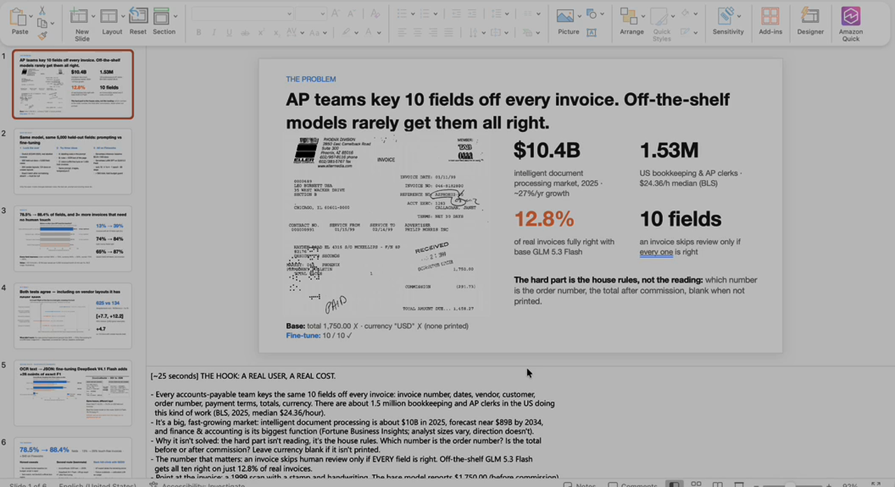
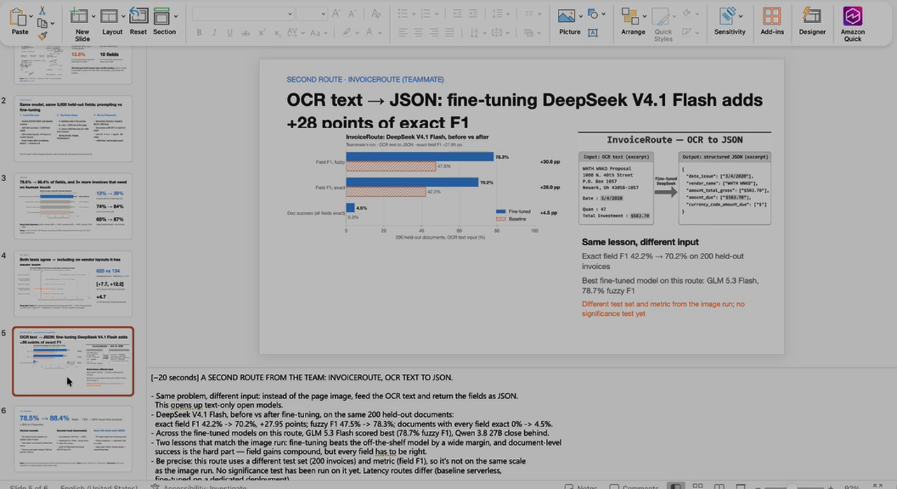
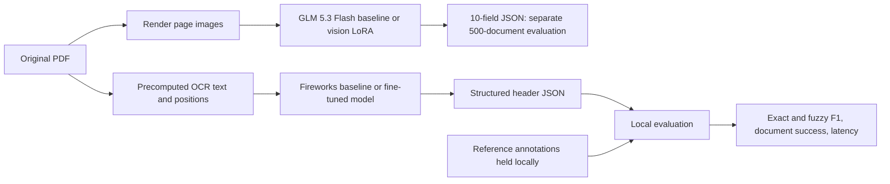

# InvoiceRoute

**Extract structured invoice data from PDF pages or OCR text, and measure what fine-tuning improves.**

InvoiceRoute is a Fireworks hackathon project for accounts-payable document extraction. The team evaluated two input routes: **PDF document pages rendered as images** with GLM 5.3 Flash, and **OCR text** with four model families. Both return structured business fields. This workspace contains the OCR data preparation tools, Fireworks inference harness, saved OCR predictions, scoring code, deployment documentation, and presentation assets. The supplied slide deck documents the separate GLM vision experiment.

On the same **200 held-out documents**, fine-tuned DeepSeek V4.1 Flash improved **exact field F1 from 42.22% to 70.17%: +27.95 percentage points**. Fuzzy field F1 improved from **47.53% to 78.33%**. Fully correct documents increased from **0/200 to 9/200**.

For the **GLM PDF/vision route**, the team reports field accuracy improving from **78.5% to 88.4%**, and fully correct documents from **12.8% to 38.8%**, on **500 held-out documents**. This uses a different metric and test set from the OCR comparison.

## Presentation

[](docile-forge-5-slides.pptx)

**[View or download the presentation](docile-forge-5-slides.pptx)** - 6 slides covering the problem, data, GLM PDF/vision results, and OCR-to-JSON evaluation.

## Demo video

[](docs/media/demo_video.mp4)

**[Watch or download the demo video](docs/media/demo_video.mp4)** · 2 minutes 48 seconds · approximately 20 MB

The recording presents the accounts-payable problem, a teammate's vision-based experiment, and the InvoiceRoute OCR-to-JSON results. Open the MP4 link if your Markdown viewer does not play video inline.

The video contains **two distinct experiments**:

| Experiment | Input and evaluation | Reported result | Evidence here |
| --- | --- | --- | --- |
| InvoiceRoute | OCR text; 200 held-out documents; field/value F1 | DeepSeek exact F1: 42.22% → 70.17% | Local raw predictions, scoring scripts, and exported reports |
| GLM 5.3 Flash PDF/vision | PDF pages rendered as images; 500 held-out documents; 10-field task | Field accuracy: 78.5% → 88.4%; fully correct documents: 12.8% → 38.8% | Supplied slides and video; underlying run artifacts are outside this workspace |

These use different inputs, test sets, and metrics. The GLM PDF/vision results are slide-reported and appear in their own table below; they are not pooled with OCR scores. The recorded presentation is not a runnable application frontend; this workspace currently provides command-line data and evaluation tools.

## What the project does

Invoice extraction requires distinguishing vendor from customer, invoice date from due date, and total amount from outstanding balance. Recognizing the text alone does not resolve these meanings.



The locally reproduced OCR route sends **OCR text** to the language model. The slide-reported GLM PDF route uses **rendered page images**; it does not establish direct upload of raw PDF bytes to the model API. The evaluation set already has precomputed OCR, so no OCR service runs during these comparisons. Expected answers remain local and are never included in inference requests.

The broader product direction includes deterministic validation, selective escalation, and human review. Those workflows are future work, not established capabilities of this evaluation harness.

## Data used

### Source: DocILE

The source collection is DocILE's **real annotated business documents**, downloaded as `annotated-trainval.zip`. The local archive contains **5,680 documents**: **5,180 official training** and **500 official validation** documents. The separately offered synthetic, unlabeled, and official test archives are not part of this download. The experiments documented here use real DocILE documents, not generated synthetic training examples.

Each source document has three preserved files:

| File | Contents | Local location |
| --- | --- | --- |
| PDF | Original document pages | `data/docile/pdfs/<document_id>.pdf` |
| OCR JSON | Recognized words, lines, pages, and geometry | `data/docile/ocr/<document_id>.json` |
| Annotation JSON | Field labels, text values, bounding boxes, line-item information, metadata | `data/docile/annotations/<document_id>.json` |

The original PDFs, OCR, annotations, and archive are preserved. Derived JSONL files are separate. The source preservation check verified **17,043 archive members** by size and ZIP CRC. See [source data inventory](docs/data.md) for details.

### OCR hackathon split

The reduced, converted files supplied for this experiment contain:

| Purpose | File | Documents | Share |
| --- | --- | ---: | ---: |
| Training | `train.jsonl` | 1,500 | 81.1% |
| Validation | `val.jsonl` | 150 | 8.1% |
| Held-out evaluation | `val_eval.jsonl` | 200 | 10.8% |
| **Total** | | **1,850** | **100%** |

These are the prepared file counts, not a claim that every teammate's training job consumed exactly these files or the same number of epochs. Teammates handled fine-tuning. Their full training configurations are not recorded here.

The 200-document evaluation set contains **141 tax invoices, 42 orders, 6 sales orders, 9 receipts, and 2 purchase orders**. It is a mixed business-document test set. The split has no identical input prompts across train, validation, and evaluation; it is not certified as an unseen-vendor or unseen-layout split.

`val_eval.jsonl` is our local held-out set, **not DocILE's official hidden test set**. Its frozen SHA-256 is:

```text
82b83b10306759384c737918462b2fcd3616195c54de4f420df45d7fb3a440bc
```

The evaluated file is also preserved as `data/evals/baseline_20261102/eval_snapshot.jsonl`. Files named `train1.jsonl`, `val1.jsonl`, or `val_eval1.jsonl` are alternate supplied files and are not the basis of the reported evaluation.

### GLM PDF/vision data split

The supplied slides describe a separate **1,400-document training set** and the **500-document official DocILE validation split used as a locked evaluation set**. Ten fields per evaluation document produce **5,000 field cases**, spanning **204 layout clusters**; **124 evaluation documents** have layouts absent from training. A separate tuning-validation count is not supplied in the deck. These counts must not be substituted for the OCR split above.

For this route, document pages are rendered as images: the slides report training at **1,600 px** and evaluation at **1,344 px**, with the baseline rerun at the same evaluation size. The model returns ten fields, scored by exact match after normalization; absent fields must be `null`. This differs from the OCR contract, which omits absent fields and uses arrays of strings. The vision training files, prompts, normalization implementation, and raw predictions are not present in this workspace.

### Training and inference format

The converted files use **conversational JSONL**: one JSON object per line, containing system, user, and assistant messages. The user message contains OCR; the assistant message contains the reference JSON encoded as a string. This is a conversion of the annotation structure into the model's output contract, rather than feeding native annotation files directly to the model.

Illustrative record, shortened for readability:

```json
{"messages":[{"role":"system","content":"Extract document fields as JSON."},{"role":"user","content":"WHTH WNKO Proposal\nDate : 3/4/2020\nTotal Investment : $503.70"},{"role":"assistant","content":"{\"date_issue\":[\"3/4/2020\"],\"vendor_name\":[\"WHTH WNKO\"],\"amount_total_gross\":[\"$503.70\"]}"}]}
```

Use the actual dataset prompts for reproduction; the shortened prompt above is explanatory. During evaluation, the harness sends only system and user messages.

The OCR evaluation schema supports **34 header field names**, with each present field mapped to a nonempty array of strings. Missing fields are omitted. Values retain their source formatting; a dollar sign is not automatically converted to `USD`. The task does not score bounding-box localization or line-item extraction. The full field list is in each run's `protocol.json`.

DocILE labels can be sparse, and some reference values correct OCR errors. Missing annotations do not always prove a field is absent. These limitations affect how extraction scores should be interpreted.

An earlier **45-example reviewed pilot** exists under `data/prepared/docile_pilot_v1/`; it is separate from the 1,500-row hackathon training file. [Pilot notes](docs/preparation.md) describe that earlier preparation stage.

## Models and results

### GLM 5.3 Flash: PDF document input

**Input: PDF pages rendered as images.** The baseline and fine-tuned model use the same 500-document evaluation set, images, prompt, and temperature 0, according to slides 2 through 4 and their speaker notes.

| Metric | Baseline GLM 5.3 Flash | Fine-tuned GLM 5.3 Flash |
| --- | ---: | ---: |
| Field accuracy, normalized exact match | 78.5% | **88.4%** |
| Documents with all 10 fields correct | 12.8% | **38.8%** |
| Both money fields correct | 74% | **84%** |
| Absent fields correctly left blank/null | 65% | **87%** |
| Order-number accuracy | 58% | **79%** |
| Currency accuracy | 66% | **90%** |
| Vendor accuracy | 73% | **85%** |
| Evaluation documents | 500 | 500 |
| Field cases | 5,000 | 5,000 |
| Latency p50 / p95 | Not supplied | Not supplied |

These are **team-reported results transcribed from the supplied slides**, not recomputed from local predictions. Field accuracy is not field F1; no fuzzy F1 or precision/recall values are supplied for this PDF/vision experiment. Its document-success metric requires all ten selected fields to match; the OCR metric covers the variable set of annotated header values.

**Fine-tuning setup:** Fireworks serverless vision LoRA SFT on GLM 5.3 Flash, rank **16**, learning rate **1e-4**, **1 epoch**, **88 steps**, and **1,400 training documents**. The presentation reports approximately **$36 for fine-tuning**, **$40 total experiment spend**, and **$0.24 for 500 baseline inferences**. These are that run's reported costs, not current pricing or this workspace's billing statement.

**Reported validation evidence:** 625 field disagreements favor the fine-tuned model versus 134 favoring baseline; McNemar p approximately 1e-76. A layout-cluster bootstrap with 5,000 resamples reports a 95% gain interval of **+7.7 to +12.2 percentage points**. The reported gain on 124 unseen-layout documents is **+4.7 points**. These statistical tests belong to the PDF/vision experiment and have not been reproduced here. The deck reports one run and one seed, and does not include a closed-model frontier baseline.

Source: [final slides](docile-forge-5-slides.pptx), slides 2 through 4 and 6 plus speaker notes. [Machine-readable transcription](docs/results/glm-pdf-vision-slide-reported.json).

### OCR input: four-model comparison

All baseline rows and the DeepSeek fine-tuned row below were scored locally on the frozen 200-document set. The other three fine-tuned rows were supplied by the team; their scoring equivalence has not been independently verified here.

| Model | Variant | Fuzzy F1 | Exact F1 | Exact precision / recall | All-fields-exact documents | Latency p50 / p95 |
| --- | --- | ---: | ---: | --- | ---: | --- |
| DeepSeek V4.1 Flash | Baseline | 47.53% | 42.22% | 40.15% / 44.51% | 0.0% | 1.356 / 2.092 s |
| DeepSeek V4.1 Flash | **Fine-tuned** | **78.33%** | **70.17%** | **71.81% / 68.60%** | **4.5%** | **1.135 / 3.005 s** |
| GLM 5.3 Flash | Baseline | 48.67% | 43.09% | 49.51% / 38.15% | 0.0% | 1.257 / 4.381 s |
| GLM 5.3 Flash | Fine-tuned — team-reported | 78.7% | 71.2% | 72.5% / 70.0% | 4.5% | 2.08 / 3.03 s |
| Qwen3.8 27B | Baseline | 35.15% | 31.74% | 32.13% / 31.35% | 0.0% | 2.243 / 3.464 s |
| Qwen3.8 27B | Fine-tuned — team-reported | 78.0% | 69.6% | 71.0% / 68.3% | 3.5% | 2.42 / 3.55 s |
| Nemotron Lightning 3.5 | Baseline | 17.98% | 16.01% | 14.09% / 18.53% | 0.0% | 0.845 / 3.094 s |
| Nemotron Lightning 3.5 | Fine-tuned — team-reported | 54.9% | 50.1% | 50.0% / 50.1% | 0% | 1.45 / 2.79 s |

[Combined presentation table](output/imagegen/combined-evaluation-v1.png) · [OCR-to-JSON example](output/imagegen/ocr-to-json-v1.png)

Portable result exports: [DeepSeek CSV](docs/results/deepseek-comparison.csv), [DeepSeek detailed JSON](docs/results/deepseek-comparison.json), [other baselines CSV](docs/results/other-baselines.csv), [other baselines detailed JSON](docs/results/other-baselines.json). These summaries are copied outside the ignored `data/` folder so they can travel with the README.

### How OCR scores are calculated

- **Exact field F1:** micro-averaged matching of field-name/string pairs across documents. Values must match exactly; list order is ignored, duplicates count, and extra or missing values are penalized.
- **Fuzzy field F1:** maximum one-to-one matching within the same field at ≥90% `difflib.SequenceMatcher` similarity after Unicode NFKC normalization, case-folding, and whitespace collapse. Digits and punctuation remain significant.
- **Document success:** valid output schema and every field/value instance exactly correct, with no extra or missing values.
- **Invalid output:** invalid JSON or non-object output contributes an empty prediction. Unknown fields and malformed values incur false positives in content scoring. The original harness also reports a stricter whole-document schema metric; do not substitute it for the table's content F1.
- **Latency:** successful final-attempt wall time, with interpolated p50/p95. It excludes preceding failed attempts and is not total retry time.

Generation uses temperature 0 and a 4,096-token output limit, without enforced structured decoding. GLM uses low reasoning effort; the other models use none. GLM, Nemotron, and baseline DeepSeek use chat inference; Qwen uses SDK sampling. Fine-tuned DeepSeek uses a dedicated deployment. **The latency measurements are not a controlled hardware comparison.**

This is a custom text-extraction evaluation, not an official DocILE leaderboard score. No significance test or production acceptance threshold is established for this 200-document experiment. A 70.17% field F1 does not mean 70.17% of documents are fully correct.

## Run locally

The commands below reproduce the **OCR route**. The PDF/vision training and scoring code belongs to the teammate's separate experiment and is not included here.

Use **Python 3.12** from the project root. Data preparation, chat inference, and offline scoring use the Python standard library. Cloud inference runs on Fireworks; local GPU training is not required.

### 1. Configure Fireworks

Copy `.env.example` to `.env` and set your own credentials:

```dotenv
FIREWORKS_API_KEY=your_api_key
FIREWORKS_ACCOUNT_ID=your_account_id
```

The tools also accept the legacy `.env` key name `api`. Credentials are excluded from version control. Check account access without launching inference or training:

```powershell
py -3.12 scripts/check_fireworks.py
```

### 2. Obtain the data

Use authorized DocILE access and follow its data terms. Set `DOCILE_ACCESS_TOKEN` in the process environment, then run:

```powershell
py -3.12 -u scripts/download_docile.py
```

To verify the retained source archive offline:

```powershell
py -3.12 scripts/download_docile.py --verify-local
```

The downloader does not recreate the teammate-supplied reduced split. To reproduce the reported runs, obtain the exact `train.jsonl`, `val.jsonl`, and `val_eval.jsonl` files or the frozen evaluation snapshot from the project team. Source data under `data/` is intentionally local and ignored by Git.

### 3. Run a baseline evaluation

This makes paid inference requests. Use a new run directory to preserve existing evidence:

```powershell
py -3.12 -u scripts/evaluate_fireworks.py --models deepseek --eval-file val_eval.jsonl --run-dir data/evals/my_deepseek_comparison/baseline --workers 8 --timeout 60
```

For GLM and Nemotron, use `--models glm nemotron`. Qwen's historical route requires `fireworks-ai[training]==1.2.30` and `transformers`; it creates a sampling client, not a training job. The existing workspace has its isolated dependencies in `tmp/fireworks_eval_sdk/`. Account access to the corresponding models and route is required.

Runs save a dataset snapshot, protocol, raw predictions, and summaries. Repeating the same command resumes the run; add `--retry-errors` to retry failed examples. Only inference is performed by this harness.

### 4. Evaluate a fine-tuned deployment

Use a deployment accessible to your account, preserving the same input file and generation settings:

```powershell
py -3.12 -u scripts/evaluate_fireworks.py --models deepseek --model-resource accounts/YOUR_ACCOUNT/deployments/YOUR_DEPLOYMENT --eval-file val_eval.jsonl --run-dir data/evals/my_deepseek_comparison/finetuned --workers 8 --timeout 60
py -3.12 scripts/compare_deepseek.py --run-dir data/evals/my_deepseek_comparison
```

`compare_deepseek.py` checks matching protocols, snapshots, input hashes, and complete example coverage before reporting the paired comparison. It makes no API calls.

### 5. Recompute the saved results offline

With the original local prediction directories present:

```powershell
py -3.12 scripts/compare_deepseek.py
py -3.12 scripts/summarize_other_baselines.py
```

The generic `scripts/summarize_evaluation.py` also reports exact, normalized, and strict-schema metrics. The fuzzy table uses the two commands above.

### Optional: upload datasets

```powershell
py -3.12 scripts/upload_fireworks_datasets.py --splits train val val_eval
```

Uploading registers the selected JSONL files; it does not start fine-tuning. Local evaluation reads its local snapshot and sends one document's input messages per request. It does not require a hosted evaluation dataset.

## Fine-tuned DeepSeek deployment

The verified checkpoint is `accounts/siakatakhan-pgaz2u78/models/inv-deepseek`, based on `accounts/fireworks/models/deepseek-v4p1-flash`, with a **rank-16 LoRA adapter**.

The evaluated serving resource is `accounts/korikanamanohar2-me6/deployments/inv-deepseek-demo`. It references the shared source checkpoint directly; ownership remains with the source account. Adapter export was restricted, so no weights were copied locally. Deployment and evaluation did not retrain the model.

The recorded configuration uses four B300 GPUs, FP4, zero minimum replicas, one maximum replica, and a five-minute idle scale-to-zero window. Dedicated serving has GPU-time costs separate from training and serverless token charges. Idle cold starts may require retries. The resource was working during evaluation; availability and account access must be checked before a new run. See [deployment details](docs/deepseek-deployment.md).

## Where predictions and evidence live

| Evidence | Local path |
| --- | --- |
| Latest DeepSeek baseline predictions | `data/evals/deepseek_comparison_20261102/baseline/deepseek_predictions.jsonl` |
| DeepSeek fine-tuned predictions | `data/evals/deepseek_comparison_20261102/finetuned/deepseek_predictions.jsonl` |
| GLM baseline predictions | `data/evals/baseline_20261102/glm_predictions.jsonl` |
| Qwen baseline predictions | `data/evals/baseline_20261102/qwen_predictions.jsonl` |
| Nemotron baseline predictions | `data/evals/baseline_20261102/nemotron_predictions.jsonl` |
| Evaluation inputs and reference answers | `data/evals/baseline_20261102/eval_snapshot.jsonl` |
| DeepSeek paired scores | `data/evals/deepseek_comparison_20261102/comparison.json` |
| Other baselines, matching scoring rules | `data/evals/baseline_20261102/other_baselines_table.json` |
| Deployment metadata and smoke response | `data/fireworks/deepseek_transfer/` |

Each prediction record includes `example_index`, `input_sha256`, `model_resource`, `content`, status, latency, and available usage metadata. Files can include multiple attempts: **use the last record for each `example_index`**. Match that index to the same row in the frozen snapshot. Fine-tuned GLM, Qwen, and Nemotron raw predictions are held by teammates and are not included here.

The earlier four-model directory also contains an older DeepSeek baseline run. The table in this README uses the newer paired DeepSeek run, whose exact F1 is 42.22%.

## Project map

```text
README.md                       Both input routes and OCR reproducibility guide
docile-forge-5-slides.pptx        Supplied final slides with GLM PDF/vision results
.env.example                    Credential placeholders
invoiceroute/preparation.py      Conservative source-label preparation helpers
scripts/                        Download, upload, inference, and scoring tools
docs/data.md                    Original DocILE inventory
docs/preparation.md             Earlier reviewed-pilot notes
docs/deepseek-deployment.md      Shared checkpoint and serving configuration
docs/media/                     Demo MP4 and preview
docs/results/                   Portable aggregate evaluation reports
output/imagegen/                Presentation images and generation prompts
train.jsonl / val.jsonl          Locally supplied reduced training/validation data
val_eval.jsonl                  Locally supplied 200-document evaluation set
data/                           Local source data, predictions, and run evidence
tmp/                            Local tools, dependencies, and temporary review files
```

The original project handoff and pilot notes describe earlier planning stages. This README and the linked evaluation reports describe the completed OCR experiment. There is no application server or frontend startup command in this workspace.

## Limitations and next steps

Document-level reliability remains a gap in both experiments: only 9 of 200 DeepSeek fine-tuned OCR outputs match every annotated field exactly; the slide-reported GLM PDF/vision result has all ten selected fields correct on 38.8% of documents. These different success definitions are not directly comparable. Before operational use, the next steps are to audit annotation coverage and OCR recoverability, evaluate on vendor/layout-separated data, obtain all teammate predictions for a common scorer, and add source-grounded validation with a human-review path. Line items, a routed fallback policy, and a runnable document-upload UI are future extensions.

OCR fine-tuning duration, epochs, learning rates, total training cost, and per-model training file provenance are not fully captured in this workspace. The GLM PDF/vision setup and cost figures above come from the supplied deck; its raw logs and billing records are outside this workspace. They should not be treated as the OCR experiment's training settings or billing total.

## Data access and attribution

DocILE supplies the source documents, OCR, and annotations. Use the dataset access terms provided with your authorized download. This project does not grant redistribution rights to those documents. The original data, credentials, and raw prediction files should not be published automatically with the README. No separate project code license has been declared in this workspace.

Built by the hackathon team using Fireworks for hosted models and model serving. Teammates performed fine-tuning; this workspace records data preparation, baseline inference, the DeepSeek deployment comparison, and evaluation evidence.
